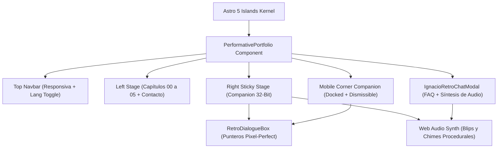

<div align="center">

  

  # IGNACIO BREÑAS MUÑOZ
  ### SOFTWARE DEVELOPER // PERFORMATIVE ARCHITECTURE

  **TypeScript Estricto · Arquitectura Modular SaaS · Docker & Linux · Barcelona**

  <br />

  [](https://astro.build)
  [](https://react.dev)
  [](https://www.typescriptlang.org/)
  [](https://tailwindcss.com/)
  [](https://www.credly.com/users/ignacio-brenas-munoz)
  [](https://github.com/Ignaciobrenas)
  [](LICENSE)

  <br />

  <!-- Action Badges -->
  <a href="https://mail.google.com/mail/?view=cm&fs=1&to=ignaciobrenas@gmail.com&su=Contacto%20Profesional%20-%20Ignacio%20Bre%C3%B1as"></a>
  <a href="https://www.linkedin.com/in/ignacio-brenas-mu%C3%B1oz-65a88a297/"></a>
  <a href="https://github.com/Ignaciobrenas"></a>
  <a href="public/cv.pdf"></a>

</div>

---

## // RESUMEN DEL SISTEMA

Portfolio interactivo de alto rendimiento con estética retro-moderna de 32 bits, motor de audio por síntesis Web Audio API en tiempo real, companion pixel-art reactivo al scroll y soporte bilingüe completo (ES/EN).

Diseñado sin plantillas genéricas ni componentes prefabricados: cada módulo está construido con rigor de ingeniería, tipado estricto en TypeScript (cero tipos `any`) y verificación de diseño responsivo pixel-perfect en escritorio, tablet y móvil.

```
ESTRUCTURA DEL PORTFOLIO // CAPÍTULOS
├── 00 // PORTADA       → Identidad, pitch técnico y accesos directos
├── SPOTLIGHT           → Hub de ingeniería: GitHub, LinkedIn y Credly
├── 01 // EXPERIENCIA   → Soterguard (Stoam SaaS · n8n), VimTech, AJMA
├── 02 // PROYECTOS     → DAMA-CRM (#1 Flagship), Argus Fraud Radar, Canva MCP...
├── 03 // STACK         → Lenguajes, Frontend, Backend, Databases y DevOps
├── 04 // CREDENCIALES  → Certificaciones oficiales Cisco Networking Academy & IBM
├── 05 // SOBRE MÍ      → Formación STUCOM Pelai (DAW/SMX), movilidad y servicios
└── CONTACTO            → Tarjeta interactiva "Hablemos", cliente mail y descarga de CV
```

---

## // PROYECTOS DESTACADOS

### 1. DAMA-CRM — CRM & ERP Modular de Alto Rendimiento (PROYECTO TOP)
- **Repositorio**: [`https://github.com/Ignaciobrenas/DAMA-CRM`](https://github.com/Ignaciobrenas/DAMA-CRM)
- **Tecnologías**: TypeScript 5+ (100% Strict), React 18, Node.js, PostgreSQL, PrismaORM, Redis, Docker, Tailwind CSS.
- **Puntos Clave**:
  - Facturación legal conforme a la norma **ISO 19005-1 (PDF/A-3b)** para la AEAT con firma digital pública por token.
  - Multi-tenancy real con aislamiento de datos por subdominio y control de acceso basado en roles (**RBAC**) con autenticación **2FA OTP**.
  - Sincronización de calendario bidireccional nativa con Apple Calendar (`webcal://`) y Google Calendar.
  - Pipeline de ventas Kanban drag & drop con reactividad en tiempo real.
  - Cobertura de calidad con más de **116 tests automatizados pasando**.

### 2. Argus Fraud Radar — Detección de Fraude en Tiempo Real
- **Repositorio**: [`https://github.com/Ignaciobrenas/Argus-Fraud-Radar`](https://github.com/Ignaciobrenas/Argus-Fraud-Radar)
- **Contexto**: Proyecto académico para el programa europeo **UNITA Erasmus+ BIP** en **STUCOM Pelai**.
- **Tecnologías**: PySpark (Arquitectura Medallion: Bronze, Silver, Gold), LightGBM, FastAPI, Streamlit, Docker.
- **Rendimiento**: Inferencia predictiva sub-15ms sobre millones de transacciones financieras con panel de radar interactivo.

### 3. Stoam SaaS & Stoam Connect (Soterguard)
- **Contexto**: Software Developer Intern en **Soterguard** ([`soterguard.com`](https://soterguard.com/)).
- **Contribución**: Participación activa en el ecosistema **Stoam SaaS**, concretamente en **Stoam Connect**, orquestando la integración de plataformas B2B y B2C mediante flujos complejos de automatización con **n8n**, APIs REST y webhooks.
- **Infraestructura**: PostgreSQL con PrismaORM, microservicios aislados en Docker, contenedores LXC y WSL.

### 4. Canva Connector MCP — AI Agent Protocol
- **Repositorio**: [`https://github.com/Ignaciobrenas/canva-connector-mcp`](https://github.com/Ignaciobrenas/canva-connector-mcp)
- **Estándar**: Implementación del **Model Context Protocol (MCP)** de Anthropic para asistentes como Claude o Cursor.
- **Seguridad**: Flujo local autónomo **OAuth 2.0 PKCE** sin riesgo de fuga de credenciales y validación estricta de esquemas Zod.

### 5. Skeleton-Meme Tool — Visión Artificial a 60 FPS sobre CPU
- **Repositorio**: [`https://github.com/Ignaciobrenas/Skeleton-Meme`](https://github.com/Ignaciobrenas/Skeleton-Meme)
- **Tecnologías**: OpenCV, MediaPipe Face Mesh, Python.
- **Optimización**: Análisis de fatiga postural y animación dinámica a 60 FPS estables corriendo íntegramente sobre CPU estándar sin requerir GPU dedicada.

---

## // TRAYECTORIA PROFESIONAL

| Empresa / Entidad | Rol | Periodo | Especialidad |
|---|---|---|---|
| **Soterguard** | Software Developer Intern | Mayo 2026 – Actualidad | Backend en Node.js, TS y Python, Stoam SaaS, n8n, PostgreSQL, Prisma, Docker, LXC |
| **VimTech** | Técnico Informático en Prácticas | Sep 2024 – Mar 2025 | Diagnóstico a nivel de componente Apple (Mac, iPhone, iPad), hardening de OS |
| **AJMA** | Operador de Cámara & Soporte Audiovisual | Mar 2023 – Ago 2025 | Realización técnica de cámara en eventos, mesas de sonido y gestión web ajma.es |

---

## // FORMACIÓN ACADÉMICA OFICIAL

- **CFGS en Desarrollo de Aplicaciones Web (DAW)**: Centro de estudios STUCOM Pelai (Barcelona) · *2025 – 2027 (2º año en curso)*
- **CFGM en Sistemas Microinformáticos y Redes (SMX / SMR)**: Centro de estudios STUCOM Pelai (Barcelona) · *2023 – 2025 (Graduado)*

---

## // CREDENCIALES VERIFICADAS EN CREDLY

Perfil oficial: [`credly.com/users/ignacio-brenas-munoz`](https://www.credly.com/users/ignacio-brenas-munoz)

- **Cisco Ethical Hacker** (`CISCO-ETH-HACKER-VERIFIED`): Auditorías de penetración, análisis de vulnerabilidades y defensa de hosts y redes.
- **IBM Agile Explorer** (`IBM-AGILE-EXPLORER-VERIFIED`): Metodologías Scrum/Kanban y ciclos iterativos de entrega continua.
- **Cisco Introduction to Cybersecurity** (`CISCO-CYBERSEC-INTRO-VERIFIED`): Criptografía, defensa perimetral y políticas de seguridad.
- **Cisco Introduction to Data Science** (`CISCO-DATA-SCIENCE-VERIFIED`): Análisis estadístico, minería de datos y pipelines analíticos.

---

## // ARQUITECTURA TÉCNICA DEL REPOSITORIO



### Características de Implementación:
- **Zero Emojis Policy**: Ningún emoji Unicode en la interfaz ni en el código; todo el soporte visual se realiza mediante iconos SVG oficiales optimizados de `lucide-react` y `react-icons`.
- **Audio Sintetizado Procedural**: Efectos de sonido retro de 32 bits generados por código mediante osciladores nativos de la `Web Audio API` (onda cuadrada, filtros paso bajo y decaimiento exponencial), sin dependencias de ficheros MP3 pesados.
- **Scrollspy Granular**: Detección milimétrica de elementos en viewport sincronizada con la pose y diálogo del personaje interactivo.
- **Modo Responsive Integral**:
  - En **ordenador (>1024px)**: Escenario sticky lateral con animaciones completas y diálogo interactivo.
  - En **tablet y móvil (<1024px)**: Companion acoplado en esquina inferior derecha (`fixed bottom-4 right-3`) con botón de cierre (`✕`), minimizable a un avatar flotante con pulso esmeralda, y barra superior con scroll horizontal de pestañas.

---

## // GUÍA DE PUESTA EN MARCHA LOCAL

### Requisitos Previos:
- Node.js 18.x o superior
- npm, pnpm o bun

### Instalación y Ejecución:

```bash
# 1. Clonar el repositorio
git clone https://github.com/Ignaciobrenas/ignaciobrenas-portfolio.git

# 2. Entrar en el directorio
cd ignaciobrenas-portfolio

# 3. Instalar dependencias
npm install

# 4. Iniciar servidor de desarrollo en local
npm run dev
# Servidor disponible en http://localhost:4321/

# 5. Compilar para producción (Build estático)
npm run build

# 6. Previsualizar compilación de producción
npm run preview
```

---

## // AUDITORÍA DE SEGURIDAD

- **Secret Scanning**: 0 credenciales, tokens o claves privadas filtradas en el repositorio.
- **Dependency Audit**: 0 vulnerabilidades conocidas reportadas por `npm audit`.
- **Cross-Site Scripting (XSS)**: Cero usos de `dangerouslySetInnerHTML`.
- **Reverse Tabnabbing**: 100% de los enlaces externos con `target="_blank"` implementan `rel="noopener noreferrer"`.
- **Environment Exclusions**: Reglas estrictas en `.gitignore` para bloquear ficheros `.env`, `.env.*` y artefactos temporales.

---

## // CONTACTO & DISPONIBILIDAD

- **Ubicación**: Barcelona, España.
- **Disponibilidad**: Incorporación inmediata para proyectos de ingeniería de software (Presencial, Híbrido o Remoto).
- **Teléfono**: [+34 640 770 380](tel:+34640770380)
- **Correo Directo**: [ignaciobrenas@gmail.com](mailto:ignaciobrenas@gmail.com)
- **LinkedIn**: [linkedin.com/in/ignacio-brenas-muñoz](https://www.linkedin.com/in/ignacio-brenas-mu%C3%B1oz-65a88a297/)
- **GitHub**: [github.com/Ignaciobrenas](https://github.com/Ignaciobrenas)
- **Credly**: [credly.com/users/ignacio-brenas-munoz](https://www.credly.com/users/ignacio-brenas-munoz)

---

<div align="center">
  <p font-family="monospace">
    <em>Ignacio Breñas Muñoz · Software Developer · Barcelona 2026</em>
  </p>
</div>
