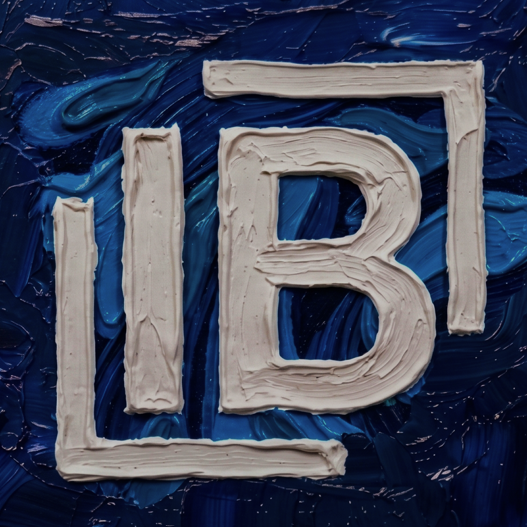
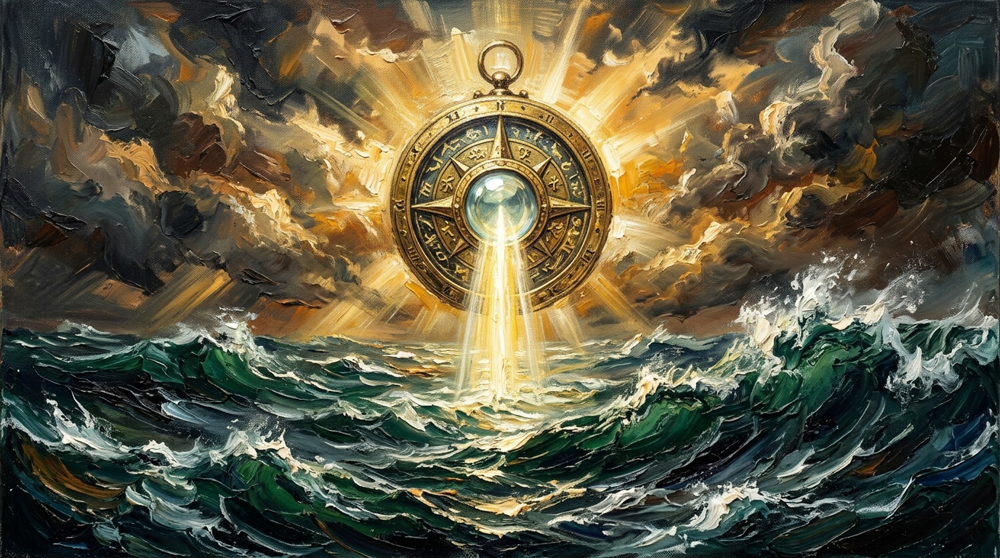
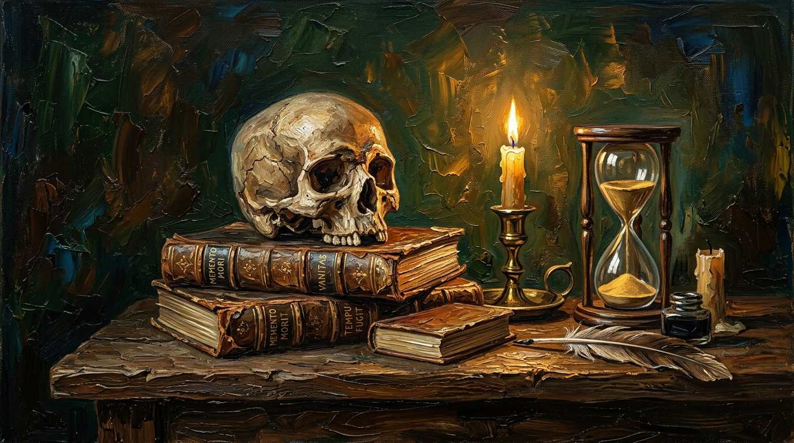
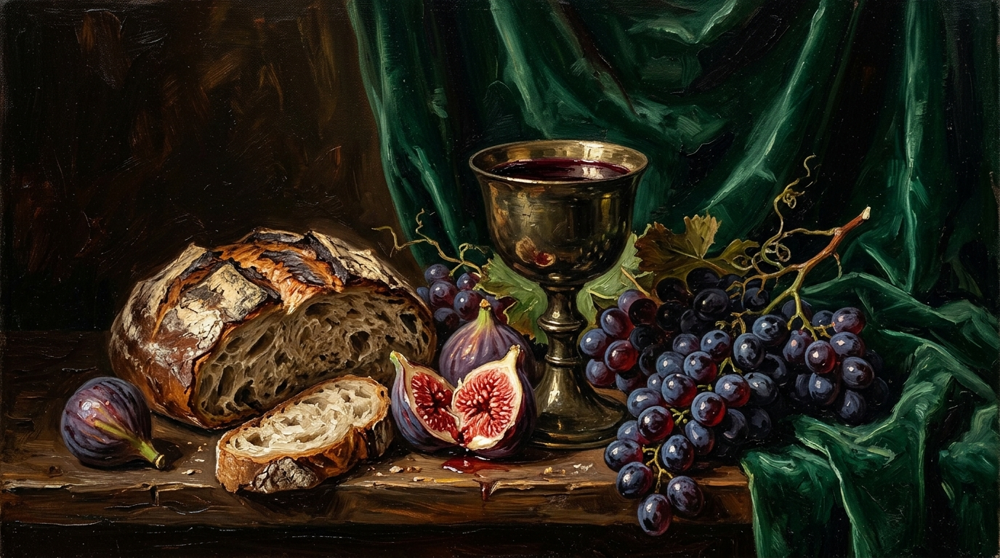
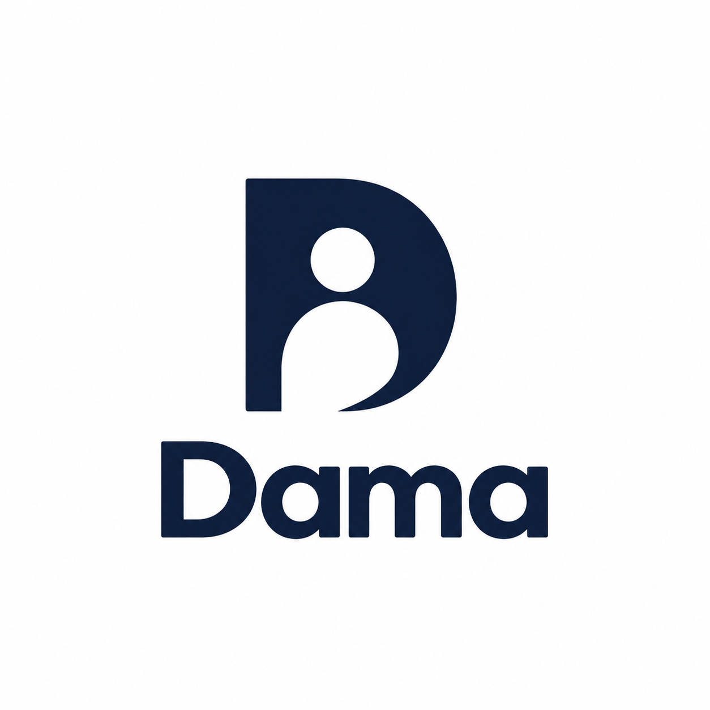

<div align="center">

  

  # IGNACIO BREÑAS MUÑOZ
  ### MUSEO DE ARTE & INGENIERÍA DE SOFTWARE
  **Arquitectura de Sistemas · Ecosistema Full-Stack · Óleo sobre Lienzo**
  
  *Barcelona, España · Disponible para Barcelona y alrededores (Presencial / Híbrido / Remoto)*

  <br />

  [](https://astro.build)
  [](https://www.typescriptlang.org/)
  [](https://nodejs.org/)
  [](https://tailwindcss.com/)
  [](https://stucom.com/)

  <br />

  <!-- Direct Hiring Badges -->
  <a href="https://mail.google.com/mail/?view=cm&fs=1&to=ignaciobrenas@gmail.com&su=Propuesta%20de%20Contrataci%C3%B3n%20/%20Proyecto%20-%20Ignacio%20Bre%C3%B1as&body=Hola%20Ignacio,%0A%0AHe%20visto%20tu%20portfolio%20y%20nos%20gustar%C3%ADa%20conversar%20sobre%20una%20oportunidad%20profesional%20en%20nuestro%20equipo..."></a>
  <a href="https://outlook.live.com/mail/0/deeplink/compose?to=ignaciobrenas@gmail.com&subject=Propuesta%20de%20Contrataci%C3%B3n%20/%20Proyecto%20-%20Ignacio%20Bre%C3%B1as&body=Hola%20Ignacio,%0A%0AHe%20visto%20tu%20portfolio%20y%20nos%20gustar%C3%ADa%20conversar%20sobre%20una%20oportunidad%20profesional%20en%20nuestro%20equipo..."></a>
  <a href="public/CV_IgnacioBrenas.pdf"></a>

  <br /><br />

  
  
  <p><em>«La precisión del código. El alma del lienzo al óleo.»</em></p>

</div>

---

## 🏛️ El Manifiesto & La Visión Curatorial

Este repositorio alberga la experiencia interactiva concebida para presentar la trayectoria, principios de ingeniería y obras de software de **Ignacio Breñas Muñoz**. Desarrollada como una **galería de bellas artes de estilo renacentista contemporáneo**, en tonos verde bosque profundo (`#030805` / `#06120a`), acentos en oro viejo y latón pulido (`#cfa859`), e ilustraciones originales trabajadas al **óleo sobre lienzo con técnica de impasto matérico**.

### 📍 Ubicación & Disponibilidad
* **Residencia**: Barcelona, España.
* **Ámbito geográfico**: Disponible para posiciones en **Barcelona y alrededores**.
* **Modalidad de trabajo**: Presencial, Híbrido o Remoto.
* **Despacho electrónico**: [ignaciobrenas@gmail.com](mailto:ignaciobrenas@gmail.com)

---

## 🖼️ Las Salas de Exposición

```
MUSEO DE ARTE & INGENIERÍA // GUÍA DE SALAS
├── FOYER PRINCIPAL      → El Lienzo al Óleo Central (Monograma IB Impasto 3D)
├── SALA I · MANIFIESTO  → Monografía del Artesano & 7 Tesis Fundacionales
├── SALA II · OBRAS      → Colección de Masterpieces al Óleo & Código Fuente
├── SALA III · ATELIER   → Vitrinas de Instrumentos, Lenguajes & Ecosistemas
├── SALA IV · TRAYECTORIA→ Anales de Experiencia Laboral (Soterguard, VimTech, AJMA)
├── SALA V · ACADEMIA    → Diplomas STUCOM Pelai (DAW/SMR) & Archivo de 20+ Trabajos
└── SALA VI · SALÓN      → Salón de Adquisiciones & Accesos Directos de Contratación
```

---

## 🎨 Obras Maestras al Óleo Destacadas

| Obra al Óleo | Título & Descripción | Tecnologías & Médiums | Enlaces |
| :--- | :--- | :--- | :--- |
|  | **Canva Connector MCP**<br>Conector autónomo para agentes inteligentes mediante el protocolo MCP con OAuth 2.0 PKCE. | `Node.js` `Model Context Protocol` `OAuth 2.0` `Canva API` | [GitHub](https://github.com/Ignaciobrenas/canva-connector-mcp) |
|  | **Argus Fraud Radar**<br>Detección bancaria de fraude en tiempo real. Galardonado en el programa UNITA Erasmus+ BIP. | `PySpark` `Medallion Architecture` `LightGBM` `FastAPI` | [GitHub](https://github.com/Ignaciobrenas/Argus-Fraud-Radar) |
|  | **Skeleton-Meme Productivity**<br>Ergonomía y vigilancia postural no invasiva mediante Face Mesh de 468 puntos. | `Python` `MediaPipe` `OpenCV` `Computer Vision` | [GitHub](https://github.com/Ignaciobrenas/Skeleton-Meme) |
|  | **RunAndEat 2.0.0**<br>Plataforma para reservas gastronómicas y dinamización de eventos urbanos. | `Laravel 11` `Vue.js` `Tailwind CSS` `MySQL` | [GitHub](https://github.com/Ignaciobrenas/RunAndEat-2.0.0) |
|  | **DAMA-CRM**<br>Sistema empresarial de gestión de oportunidades mercantiles con persistencia relacional estricta. | `TypeScript` `Node.js` `PostgreSQL` `PrismaORM` | [GitHub](https://github.com/Ignaciobrenas/DAMA-CRM) |

---

## 🧰 El Atelier Técnico

### 1. Lenguajes Fundacionales
* **TypeScript** — Tipado estricto, contratos de interfaces y arquitecturas escalables.
* **JavaScript (ES6+)** — Programación asíncrona, event loops y microservicios.
* **Node.js** — Servicios de backend, APIs RESTful de baja latencia y CLI tooling.
* **Python** — Pipelines analíticos, procesamiento masivo y modelos de visión artificial.
* **PHP 8.x** — Backend estricto en STUCOM, patrones Strategy y tests con PHPUnit.
* **Java** — Principios de POO puros, patrón DAO, JDBC y concurrencia.

### 2. Marcos & Estructuras
* **Astro** — Arquitectura de islas, rendimiento de carga estática ultrarrápida.
* **React 18 / 19** — Componentes declarativos, hooks avanzados, estado.
* **Three.js / WebGL** — Escenas interactivas 3D y renderizado en navegador.
* **Laravel 11** — Arquitectura MVC enterprise, Eloquent ORM y autenticación.
* **Symfony** — Framework robusto PHP, inyección modular de dependencias.

### 3. Persistencia & Almacenamiento
* **PostgreSQL** — Consultas relacionales complejas, índices, transacciones ACID.
* **PrismaORM** — Modelado declarativo relacional y queries con type-safety estricto.
* **MySQL** — Esquemas relacionales y procedimientos almacenados.

### 4. Sistemas, Virtualización & DevOps
* **Docker & Contenedores LXC** — Aislamiento de entornos y despliegues virtualizados.
* **Linux SysAdmin & WSL** — Administración de servidores, automatizaciones Bash y políticas POSIX.
* **Git & GitHub CI/CD** — Flujo de trabajo colaborativo GitFlow y auditoría de código.

---

## 📜 Formación & Acreditaciones STUCOM Pelai

* **CFGS en Desarrollo de Aplicaciones Web (DAW)** — STUCOM Pelai, Barcelona *(2025 – 2027)*
* **CFGM en Sistemas Microinformáticos y Redes (SMR)** — STUCOM Pelai, Barcelona *(2023 – 2025)*
* **Archivo Académico**: Más de 20 proyectos catalogados y auditados que aplican patrones de diseño arquitectónico (DAO, Strategy, MVC), refactorización de código defectuoso (QA) y tests unitarios.

---

## ⚡ Instalación & Ejecución Local

```bash
# 1. Clonar el repositorio
git clone https://github.com/Ignaciobrenas/ignaciobrenas-portfolio.git

# 2. Entrar al directorio
cd ignaciobrenas-portfolio

# 3. Instalar dependencias
npm install

# 4. Iniciar el servidor de desarrollo en Astro
npm run dev

# 5. Compilar la versión de producción optimizada
npm run build

# 6. Previsualizar la compilación de producción
npm run preview
```

---

## 📬 Canales Directos de Contratación

* 📩 **Correo Electrónico**: [ignaciobrenas@gmail.com](mailto:ignaciobrenas@gmail.com)
* 💼 **LinkedIn**: [linkedin.com/in/ignacio-brenas-munoz](https://linkedin.com/in/ignacio-brenas-munoz)
* 🐙 **GitHub**: [github.com/Ignaciobrenas](https://github.com/Ignaciobrenas)
* 📄 **Curriculum Vitae**: [Descargar CV Oficial en PDF](public/CV_IgnacioBrenas.pdf)

---

<div align="center">
  <sub>Diseñado y desarrollado por Ignacio Breñas Muñoz · © 2026 Todos los derechos reservados.</sub>
</div>
